# SigenStorPanel

A 10.1″ touchscreen wall panel for a Sigenergy SigenStor solar and battery system.

It runs on the Elecrow **CrowPanel Advanced 10.1″ ESP32-P4 HMI**, a 1024×600 IPS
touchscreen with WiFi. It shows:

- live power flow and battery state;
- solar generation against forecast;
- consumption and the grid;
- where the day's energy went, and what it all cost.

Everything is set up on the glass itself: WiFi, the data source and every setting. There
is no setup network to join and no web page to find.

It is the big sibling of [SigenStorPuck](https://github.com/markab/SigenStorPuck), which
shows the same data on small round and landscape AMOLED boards. The two share their data
layer.

**Status: early-release testing.** It runs on a real board (hardware revision V1.2):

- **Confirmed:** the display, touch and WiFi, plus the server, Modbus and solar forecast
  paths.
- **Not yet tried:** the Home Assistant path on a real Home Assistant, the BOOT button and
  the room sensor.

## Three ways to get data: read this first

The panel can take its readings from one of three places. It matters which, because some
screens and features need a particular one.

**Modbus TCP, talking straight to your plant.** No other software is involved. The panel
reads your inverter or gateway directly over your own network. This is the default for a
new installation.

**SigenStorDisplay Server.** A separate companion application that manages and logs a
Sigenergy plant, which the panel can then read from. It unlocks:

- the Flows and Cost screens;
- stepping back through past days;
- complete daily charts.

**SigenStorDisplay has not been released yet.** The panel already has full support for it,
ready for when it is. Until then, those parts are unavailable.

**Home Assistant.** The panel reads chosen sensors through Home Assistant's REST API. This
suits a home where Home Assistant already collects from the inverter, battery and meters:
the panel reads what Home Assistant has, rather than becoming another Modbus client. You
pick which sensor supplies each figure from Home Assistant's own list, so this works with
any inverter and battery integration, not only Sigenergy's.

### What works with which

| | Modbus | SigenStorDisplay Server | Home Assistant |
|---|:--:|:--:|:--:|
| **Power** screen | ● | ● | ● |
| **Battery** screen | ● | ● | ● |
| **Solar** screen | ● | ● | ◐ by default; ● with a forecast set up |
| **Home use** screen | ◐ headline and live draw only | ● | ◐ headline and live draw only |
| **Grid** screen | ● frequency and voltage need an inverter added | ● | ◐ no frequency or voltage |
| **Energy flows** screen | — | ● | — |
| **Cost** screen | — | ● | — |
| Solar forecast | ● calculated on the panel | ● from the server | ● off, from the panel, or from Home Assistant sensors |
| Today's charts | ◐ from when the panel was switched on | ● the whole day, even after a restart | ◐ restored from Home Assistant's history where it has one; otherwise from switch-on |
| Step back through past days | — | ● up to 7 days | — |
| Tariff rates and savings | — | ● | — |

● full · ◐ partial · — not available

On Modbus and Home Assistant, the Energy flows and Cost screens are removed altogether
rather than left showing dashes, so you get five screens instead of seven.

## The screens

**Swipe left and right across the glass to move between screens.** The row of dots near
the bottom shows how many there are and which one you are on. The auto-cycle can also
step through them on its own (see **Screens** under Settings).

**Swipe up from anywhere to open Settings.** It slides up over the screen you were on.
Swipe down, or tap **Done**, to close it. It also closes by itself after a minute
untouched.

| | |
|:--:|:--:|
| 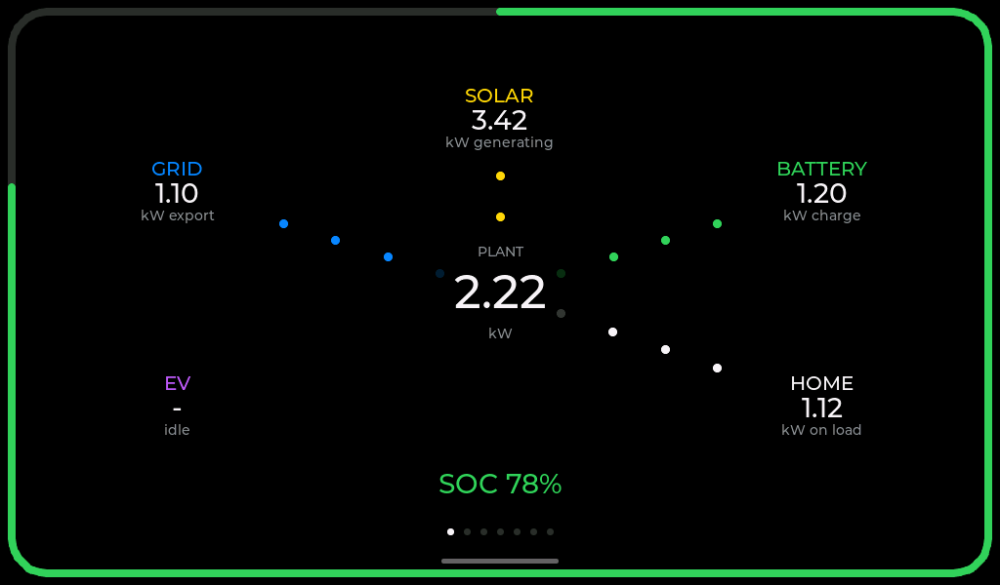 | 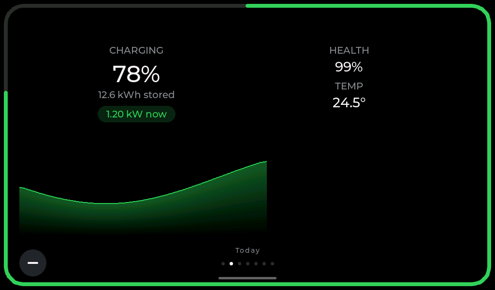 |
| **Power**: what is happening right now. Solar at the top, battery and home to the right, grid and EV to the left, all around the plant in the middle. Dots run along each leg in the direction the power is going: slowly near zero, faster as it rises towards 20 kW. The bar around the edge is your battery's state of charge.<br><br>*Works on all three sources when the values are available.* | **Battery**: charge level, kWh stored, and what it is doing now, over the day's charge curve. Health and temperature on the right.<br><br>*Works on all three sources. On Modbus, temperature needs an inverter added under Devices; on Home Assistant, each figure needs its sensor chosen.* |
| 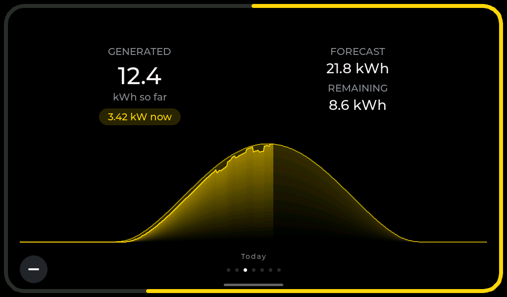 | 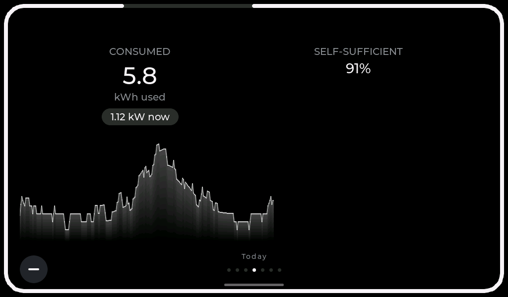 |
| **Solar**: generated so far today and live output, over the day's curve with the forecast behind it. The forecast total and what is still to come are on the right. The bar around the edge is progress against the day's forecast.<br><br>*Works on all three sources.* | **Home use**: everything used today, with what is being drawn now and how self-sufficient you have been.<br><br>*Partial on Modbus and Home Assistant.* The total, live figure and locally recorded curve work. The breakdown by source needs a **SigenStorDisplay Server**. |
| 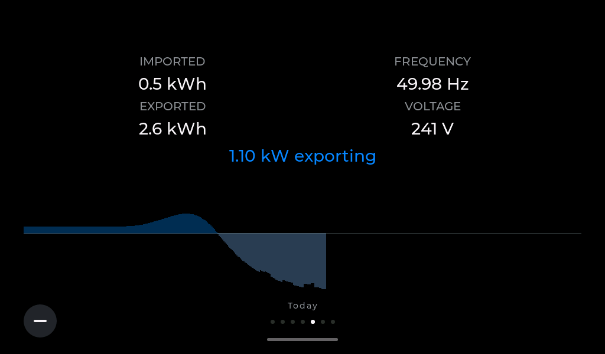 | 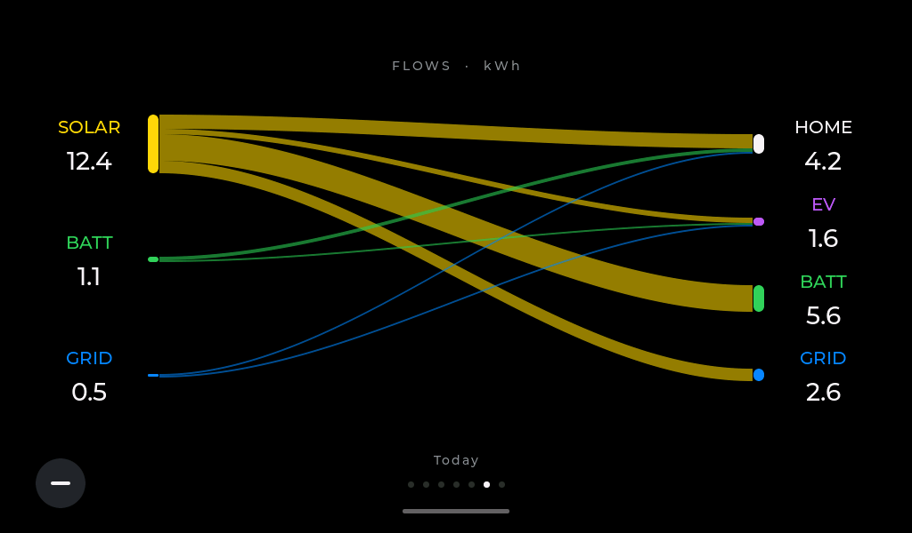 |
| **Grid**: imported and exported today, live frequency and voltage, and the day's import above the line and export below it.<br><br>*Works on all three sources.* Frequency and voltage need an inverter added on Modbus, and are not available from Home Assistant. | **Energy flows**: where today's energy came from and where it went. Sources down the left, destinations down the right, one ribbon per path.<br><br>**SigenStorDisplay Server only.** |
| 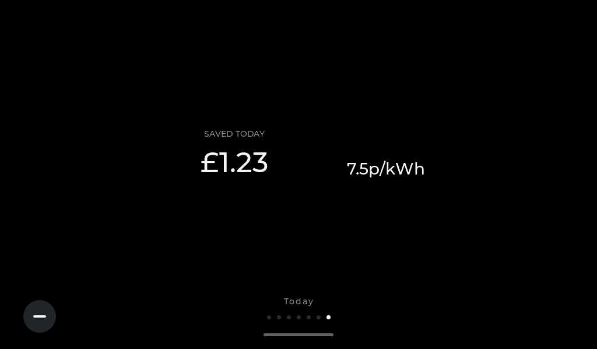 | |
| **Cost**: what you have saved today and the unit rate you are paying right now.<br><br>**SigenStorDisplay Server only.** | |

Behind the battery, solar, home and grid figures is that day's own curve:

- **Modbus:** the curves fill from when the panel was switched on.
- **Home Assistant:** the panel restores today's curves from Home Assistant's history after
  its first successful reading, a two-hour window at a time between live readings. Where
  there is no history, the curves fill from switch-on.
- **SigenStorDisplay Server:** the whole day is fetched, so the curves are complete
  straight away.

### Past days

With a **SigenStorDisplay Server**, **−** and **+** buttons sit in the bottom corners of
every screen except Power:

- **−** steps back a day, up to seven days.
- **+** steps forward again.
- The day you are looking at is named just above the page dots.
- Left alone for two minutes, the panel goes back to today by itself.

The Power screen always stays live. On Modbus and Home Assistant there is no stored history
to step back into, so the buttons do not appear.

### When something needs attention

Problems show as a line across the top of whichever screen is up, with the screen still
visible underneath. **Tap the line** to open the settings page that fixes it.

| Colour | Means |
|---|---|
| Grey | Something is in progress: connecting to WiFi, setting the clock, waiting for the first reading. It passes by itself. |
| Amber | Something needs setting up: no WiFi, or no data source configured yet. |
| Red | Set up, but refused or unreachable: a rejected code or token, or a source that does not answer. |

## Installing

### 1. Flash the firmware

Plug the panel's UART USB-C port into a computer, switch it on, and open this page in
**Chrome or Edge**:

### → [Install SigenStorPanel](https://markab.github.io/SigenStorPanel/)

It flashes over WebSerial, with no flashing tool to download. Safari and Firefox cannot
do this, and neither can anything on an iPhone or iPad. *The installer page is not
published yet. Until it is, build and flash the firmware yourself; see **Building it
yourself** below.*

The panel's USB port goes through a WCH CH340 serial chip. **On a Mac, install WCH's
CH34xVCPDriver first**, from the Mac App Store, open it once, and allow its driver
extension in System Settings when macOS asks. Without it, the panel's serial port does
not appear. Windows and Linux normally have the driver already.

If the installer cannot connect, hold **BOOT**, press and release **RST**, let go of
BOOT, and try again.

After the first flash, the panel can update itself (see **Firmware** under Settings).

### 2. Join it to your WiFi

On first boot the panel looks for networks and lists them.

<p align="center">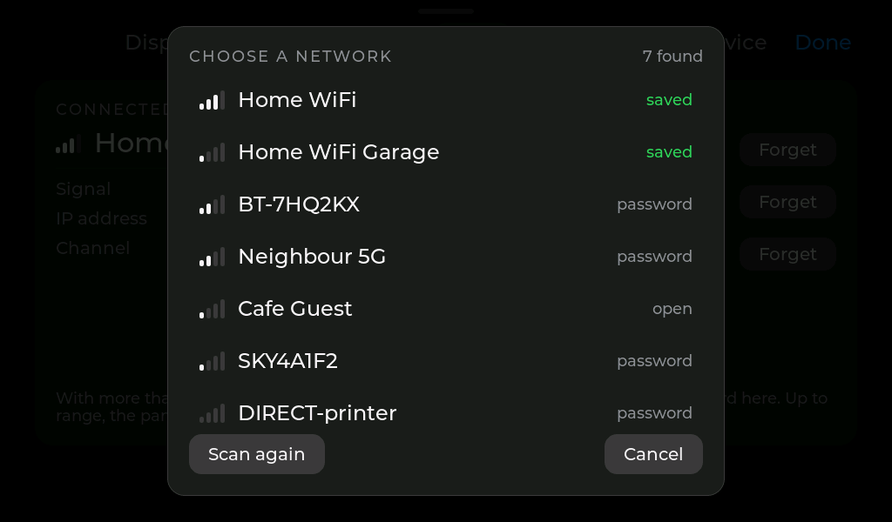</p>

1. Tap your network.
2. Type its password on the on-screen keyboard and tap **Join**.

The panel remembers up to five networks. With more than one in range, it joins the
strongest. To add another later, open **WiFi** in Settings.

### 3. Choose and configure a data source

Open Settings (swipe up), then **Data**. Choose the source at the top. A change of source
takes effect after a restart; the panel offers one.

<p align="center">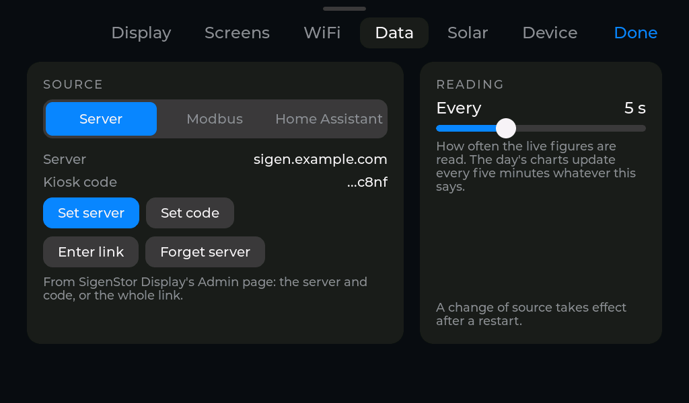</p>

#### Direct Modbus

1. Choose **Modbus**.
2. Tap **Set** and enter the IP address of your inverter or gateway.
3. Optionally, tap **Edit** by Devices. Add your inverter for battery temperature, grid
   frequency and voltage, and the daily totals. Add a charger, if you have one, for EV
   power. Use the IDs the Sigen app lists. The plant itself is `247` unless you have
   changed it.

Do two things outside the panel, or it will not be able to connect:

- **In the Sigen app**, allow Modbus TCP access for the panel's IP address. Access is
  granted per address, and a device that has not been added gets no reply. The panel's
  address is on the **Device** page.
- **In your router**, give the panel a fixed (reserved) IP address. Otherwise the
  permission you just granted stops working the next time addresses are handed out.

Data should appear within a few seconds.

#### SigenStorDisplay Server

Once it is available, choose **Server**. The server's Admin page gives each display unit
a server address and a kiosk code. Enter them one of two ways:

- **Set server** and **Set code**, typed separately. Dashes and capitals in the code don't
  matter.
- **Enter link**, for the whole enrolment link in one go.

#### Home Assistant

You need:

- a Home Assistant the panel can reach;
- energy sensors from any integration;
- a long-lived access token.

To make the token, create a dedicated local non-administrator user in Home Assistant for
the panel. Sign in as that user, open its profile, and create a
[**long-lived access token**](https://developers.home-assistant.io/docs/auth_api/#long-lived-access-token).
Avoid using an administrator's everyday token. Revoking this one later removes the panel's
access at once.

1. Choose **Home Assistant**.
2. **Set address**: the base URL, with the scheme and port, such as
   `http://homeassistant.local:8123`.
3. **Set token**: type or paste the token. It is stored on the panel only, and shown
   afterwards as its last few characters.
4. **Sensors: Choose.** Tap each figure and pick its sensor from Home Assistant's own
   list. The list is filtered to sensors in a unit that figure can use, and shows each
   one's current value, so you can see which is live.

<p align="center">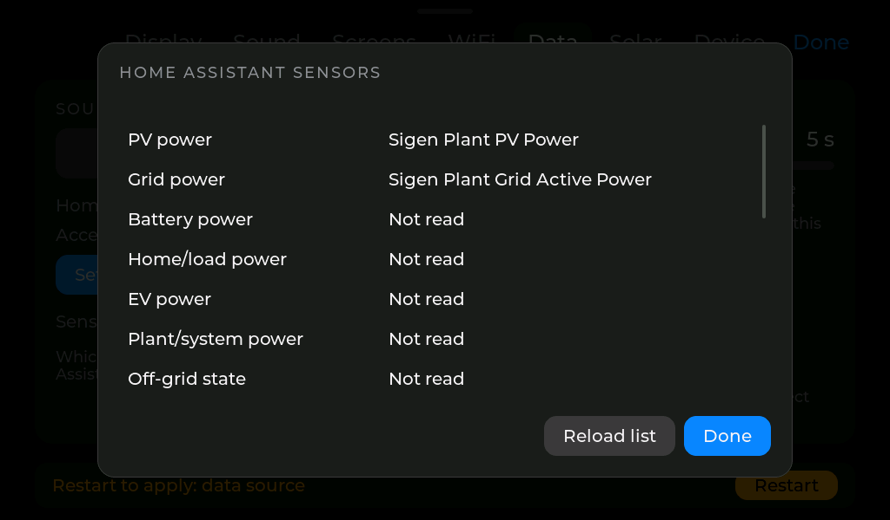</p>

The panel sends one [`POST /api/template`](https://developers.home-assistant.io/docs/api/rest/#post-apitemplate)
per reading. Home Assistant answers with only the chosen sensors and their units, so the
panel never downloads every state. In this mode the panel never opens a Modbus
connection.

## Settings

Everything below is in the sheet that slides up over the screens. It has six pages,
**Display**, **Screens**, **WiFi**, **Data**, **Solar** and **Device**, and you swipe
left and right between them.

Most changes take effect straight away. The ones that need a restart are marked ↻. Changing
one puts up a bar listing what is waiting, with a button to restart.

### Display

<p align="center">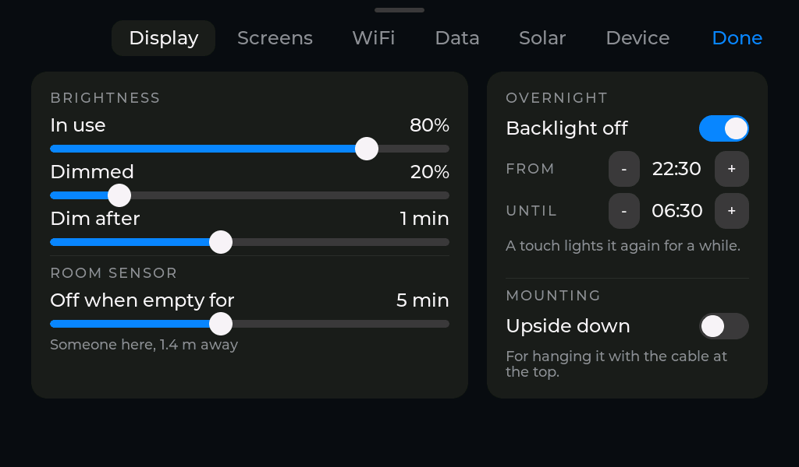</p>

<table>
<tr><th width="32%">Option</th><th>What it does</th></tr>
<tr><td><strong>In use</strong></td><td>Normal brightness. The screen shows it live while you drag.</td></tr>
<tr><td><strong>Dimmed</strong></td><td>How dim it goes when left alone. It dims rather than going dark, so it stays readable from across the room.</td></tr>
<tr><td><strong>Dim after</strong></td><td>How long without a touch before it dims, or never.</td></tr>
<tr><td><strong>Off when empty for</strong></td><td>With the optional room sensor (see <strong>Room sensor</strong> below): how long the room must be empty, with nobody touching the panel, before the backlight goes off. Never, or 1 to 60 minutes. Someone walking in brings it straight back. Below the slider is what the sensor sees right now.</td></tr>
<tr><td><strong>Overnight: Backlight off, From, Until</strong></td><td>Hours to switch the backlight off completely. <strong>Off means off, not dimmed.</strong> A touch lights it again for a while. Inside these hours, the room sensor does not wake it.</td></tr>
<tr><td><strong>Upside down</strong> ↻</td><td>For hanging the panel with the cable at the top.</td></tr>
</table>

### Screens

<table>
<tr><th width="32%">Option</th><th>What it does</th></tr>
<tr><td><strong>Show</strong> ↻</td><td>A tick per screen for whether it appears at all. Power is always shown. On Modbus and Home Assistant, Energy flows and Cost are unavailable.</td></tr>
<tr><td><strong>Cycle</strong></td><td>A second tick per screen for whether the auto-cycle stops on it.</td></tr>
<tr><td><strong>Cycle screens, Every</strong></td><td>Steps through the screens marked Cycle by itself, this often. It waits while someone is touching the panel.</td></tr>
</table>

### WiFi

<table>
<tr><th width="32%">Option</th><th>What it does</th></tr>
<tr><td><strong>Connected to</strong></td><td>The network in use, its signal, the panel's IP address and the channel.</td></tr>
<tr><td><strong>Saved networks</strong></td><td>Up to five. <strong>Forget</strong> asks you to tap again to confirm.</td></tr>
<tr><td><strong>Add a network</strong></td><td>Opens the network list. Pick one and type its password.</td></tr>
</table>

### Data

<table>
<tr><th width="32%">Option</th><th>What it does</th></tr>
<tr><td><strong>Source</strong> ↻</td><td><strong>Server</strong>, <strong>Modbus</strong> (the default) or <strong>Home Assistant</strong>. Below it are that source's own settings, as described under <strong>Installing</strong>.</td></tr>
<tr><td><strong>Forget server</strong></td><td><em>Server only.</em> Clears the server address and code.</td></tr>
<tr><td><strong>Reading: Every</strong></td><td>How often the live figures are read, in seconds. <code>5</code> is the default. The day's charts update every five minutes whatever this says.</td></tr>
</table>

### Solar

<p align="center">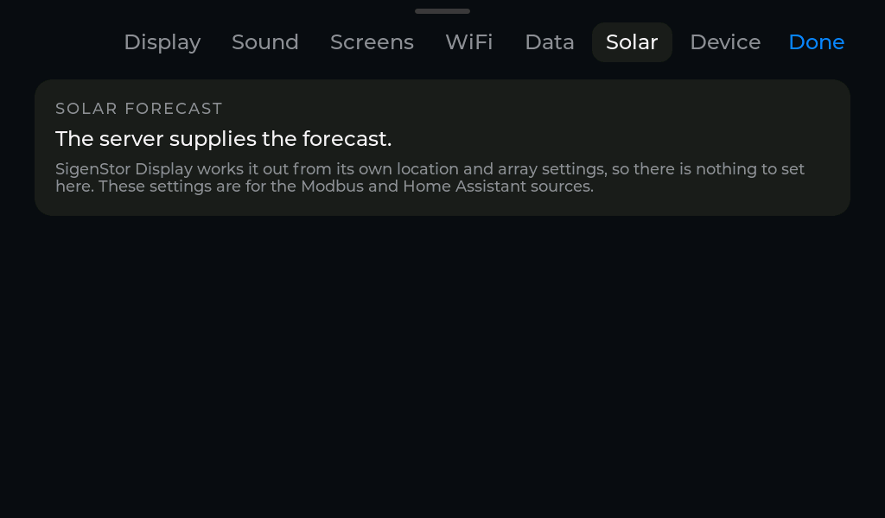</p>

With a **SigenStorDisplay Server**, the server supplies the forecast and there is nothing
to set here. On **Modbus**, the panel calculates it from the settings below. On **Home
Assistant**, choose **Off**, **This panel** (calculated from the settings below), or
**From HA** (the forecast sensors chosen under Data, Sensors).

<table>
<tr><th width="32%">Option</th><th>What it does</th></tr>
<tr><td><strong>Latitude / Longitude</strong></td><td>Where your panels are. West is negative. <strong>Leave them unset for no forecast</strong>; the Solar screen then hides its forecast rather than showing an empty one.</td></tr>
<tr><td><strong>System efficiency</strong></td><td>Everything between the panels' rating and your meter: inverter efficiency, wiring, dirt on the glass.</td></tr>
<tr><td><strong>Inverter limit</strong></td><td>The most your inverter can put out, in kW, or no limit.</td></tr>
<tr><td><strong>Arrays</strong></td><td>One per roof face with panels on it, up to four. <strong>Size</strong> is the panels' rating in kWp. <strong>Tilt</strong> is the angle from flat. <strong>Facing</strong> is a compass bearing: <code>180</code> due south, <code>90</code> east, <code>270</code> west.</td></tr>
</table>

### Device

<p align="center">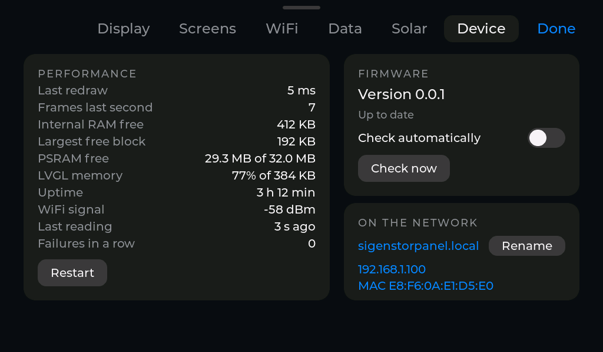</p>

<table>
<tr><th width="32%">Option</th><th>What it does</th></tr>
<tr><td><strong>Performance</strong></td><td>How fast the screen is drawing, free memory, uptime, WiFi signal, and how long ago the last reading arrived.</td></tr>
<tr><td><strong>Restart</strong></td><td>Restarts the panel. Needed after any ↻ change above.</td></tr>
<tr><td><strong>Firmware</strong></td><td>The version running. <strong>Check now</strong> looks for a newer release. <strong>Install</strong> appears when there is one; the panel shows its progress and restarts by itself. <strong>Check automatically</strong> is off by default, so the panel contacts nothing but your own network unless you ask it to. With it on, the panel checks after it starts and then every 12 hours, and a dot on the Device tab says an update is waiting. Installing is always your choice.</td></tr>
<tr><td><strong>On the network</strong></td><td>The panel's name, IP address and WiFi MAC address. The MAC is what your router lists when you reserve an address.</td></tr>
<tr><td><strong>Rename</strong> ↻</td><td>What the panel calls itself on your network. The default is <code>sigenstorpanel</code>, which answers as <code>sigenstorpanel.local</code>. Change it if you have more than one.</td></tr>
</table>

## Troubleshooting

| Across the top | What it means |
|---|---|
| **No WiFi** | No saved network is in range. Tap to choose one. |
| **Connecting to WiFi...** | Joining your network. It should pass in a few seconds. |
| **… not set up** | On WiFi, but the chosen source is missing its address, code or token. Tap to enter it. |
| **Setting the clock...** | The panel needs the time from the internet before it can make a secure connection. It passes by itself once your network lets it reach a time server. |
| **Waiting for data...** | Configured, but nothing has arrived yet. Normal just after a restart. |
| **The server rejected this panel's code** | *Server only.* The kiosk code was revoked. Create a new one on the server and enter it. |
| **Home Assistant rejected the token** | Home Assistant answered 401 or 403. Make a new long-lived token and check that its user is still active. |
| **Cannot reach …** | The source did not answer, with the reason in brackets. Check its address. On Modbus, also check the panel is still allowed in the Sigen app. |

If a Modbus setup worked and then stopped, the usual cause is that the panel's IP address
changed. That quietly invalidates the permission granted in the Sigen app. Reserve the
address in your router and grant it again.

**Holding BOOT for 5 seconds restarts the panel.** The slide switch on the side cuts power
outright.

## Room sensor (optional)

A [Waveshare HMMD mmWave sensor](https://www.waveshare.com/wiki/HMMD_mmWave_Sensor) lets
the panel switch its backlight off when nobody is in the room and back on when someone
walks in. Without one, nothing changes.

It plugs into the **UART1** socket beside the WiFi module, a 4-pin HY2.0 (2.0 mm,
Grove-style) connector. TX and RX cross over:

| UART1 pin | Sensor pin |
|---|---|
| 1 RX (GPIO48) | **TX** |
| 2 TX (GPIO47) | **RX** |
| 3 3V3 | **3V3** |
| 4 GND | **GND** |

The sensor's fifth pin, OT2, is not needed. A sensor that goes silent is ignored, so a
loose wire cannot leave the panel dark. Set how long the room must be empty under
**Display**. More detail, including an alternative on the IO breakout header, is in
[docs/HARDWARE.md](docs/HARDWARE.md).

## Hardware

| | |
|---|---|
| Board | Elecrow CrowPanel Advanced 10.1″ ESP32-P4 HMI, **V1.2** tested |
| Display | 1024×600 IPS, EK79007 over 2-lane MIPI-DSI, PWM backlight |
| Touch | GT911, I2C |
| MCU | ESP32-P4 (silicon v1.3 tested), 32 MB PSRAM, 16 MB flash |
| WiFi | through the on-board ESP32-C6 over SDIO (esp-hosted) |
| USB serial | WCH CH340, needing WCH's driver on a Mac |

Pins, timings and what is confirmed so far are in [docs/HARDWARE.md](docs/HARDWARE.md).

## Building it yourself

The firmware builds with [PlatformIO](https://platformio.org/):

```bash
pio run -e panel -t upload -t monitor
```

Screens are developed against canned readings on the desktop rather than by reflashing,
and every screenshot above came from that simulator. It needs SDL2 (`brew install sdl2`):

```bash
pio run -e sim && .pio/build/sim/program
```

Keyboard controls:

- `n` and `p` change the fixture.
- `[` and `]` change the screen.
- `s` opens Settings.
- `d` shows the parsed data behind the screen.

`--shot <dir>` renders every screen and settings page to images. `--selftest` runs the
checks that need no hardware, including:

- the Home Assistant template, sensor list and unit handling;
- the Modbus register decoder;
- the history ring;
- the solar forecast model;
- the overnight window;
- the room sensor's output.

How releases, the installer page and updates are published is in
[docs/RELEASING.md](docs/RELEASING.md).

## Home Assistant scope

Home Assistant provides:

- live power and battery values;
- today's totals, for the sensors you choose;
- an optional solar forecast, from Home Assistant sensors or the panel's own model.

One optional history fetch restores today's charts after a restart. Without usable
history, the charts fill from switch-on.

Deliberately not implemented: browsing previous days, the detailed source-to-sink flows,
tariffs and costs.
