# SigenStorPanel

A 10.1″ touchscreen wall panel for a Sigenergy SigenStor solar and battery system.

It runs on the Elecrow **CrowPanel Advanced 10.1″ ESP32-P4 HMI**, a 1024×600 IPS
touchscreen with WiFi. It shows:

- live power flow and battery state, with what the system itself is losing;
- solar generation against forecast;
- consumption and the grid;
- where the day's energy went, and what it all cost;
- grid events: Octopus Saving Sessions, free-import periods and Axle events;
- optionally, your room and outdoor sensors from an EnViOT Display server.

Everything is set up on the glass itself: WiFi, the data source and every setting. There
is no setup network to join and no web page to find.

It is the big sibling of [SigenStorPuck](https://github.com/markab/SigenStorPuck), which
shows the same data on small round and landscape AMOLED boards. The two share their data
layer: parsers, models and calculations are written once, in SigenStorPuck, and copied
here unchanged (see [UPSTREAM.md](UPSTREAM.md)).

**Status: early-release testing, version 0.2.7.** It runs on a real board (hardware
revision V1.2):

- **Confirmed:** the display, touch and WiFi; the server, Modbus and solar forecast paths;
  the Events and Environment screens; sound; updates over WiFi; and the room sensor.
- **Being watched:** occasional restarts inside the WiFi driver when it runs short of
  internal memory. 0.2.7 gives it 80 KB more; the Device page shows how close it comes
  (see [The panel restarts by itself](#the-panel-restarts-by-itself)).
- **Not yet tried:** the Home Assistant path on a real Home Assistant, and the BOOT button.

## Contents

- [Three ways to get data](#three-ways-to-get-data-read-this-first)
- [The screens](#the-screens)
- [How the figures are worked out](#how-the-figures-are-worked-out)
- [Installing](#installing)
- [Settings](#settings)
- [Updates](#updates)
- [Troubleshooting](#troubleshooting)
- [Environment sensors (optional)](#environment-sensors-optional)
- [Room sensor (optional)](#room-sensor-optional)
- [Privacy and security](#privacy-and-security)
- [Hardware](#hardware)
- [Building it yourself](#building-it-yourself)
- [Home Assistant scope](#home-assistant-scope)
- [Credits](#credits)

## Three ways to get data: read this first

The panel can take its readings from one of three places. It matters which, because some
screens and features need a particular one.

**Modbus TCP, talking straight to your plant.** No other software is involved. The panel
reads your inverter or gateway directly over your own network. This is the default for a
new installation.

**SigenStorDisplay Server.** A separate companion application that manages and logs a
Sigenergy plant, which the panel can then read from. It unlocks:

- the Energy flows, Cost and Events screens;
- stepping back through past days;
- complete daily charts, even straight after a restart;
- tariff rates and savings.

**SigenStorDisplay has not been released yet.** The panel already has full support for it,
ready for when it is. Until then, those parts are unavailable.

**Home Assistant.** The panel reads chosen sensors through Home Assistant's REST API. This
suits a home where Home Assistant already collects from the inverter, battery and meters:
the panel reads what Home Assistant has, rather than becoming another Modbus client. You
pick which sensor supplies each figure from Home Assistant's own list, so this works with
any inverter and battery integration, not only Sigenergy's.

The source is chosen under **Settings → Data**, and can be changed at any time; the panel
restarts to apply it. The **Environment** screen is separate: it reads an EnViOT Display
server alongside whichever source you use.

### What works with which

| | Modbus | SigenStorDisplay Server | Home Assistant |
|---|:--:|:--:|:--:|
| **Power** screen | ● | ● | ● |
| **Battery** screen | ● temperature needs an inverter added | ● | ● each figure needs its sensor |
| **Solar** screen | ● | ● | ◐ by default; ● with a forecast set up |
| **Home use** screen | ◐ headline and live draw only | ● | ◐ headline and live draw only |
| **Grid** screen | ● frequency and voltage need an inverter added | ● | ◐ no frequency or voltage |
| **Energy flows** screen | — | ● | — |
| **Cost** screen | — | ● | — |
| **Events** screen | — | ● | — |
| **Environment** screen | ● with an EnViOT Display server | ● with an EnViOT Display server | ● with an EnViOT Display server |
| System losses under PLANT | ● from the PV strings | ● from the server | ● with PV string sensors; ◐ without |
| Solar forecast | ● calculated on the panel | ● from the server | ● off, from the panel, or from Home Assistant sensors |
| Today's charts | ◐ from when the panel was switched on | ● the whole day, even after a restart | ◐ restored from Home Assistant's history where it has one; otherwise from switch-on |
| Step back through past days | — | ● up to 7 days | — |
| Tariff rates and savings | — | ● | — |
| Sounds for battery and car charging | ● | ● | ● with the sensors chosen |

● full · ◐ partial · — not available

On Modbus and Home Assistant, the Energy flows, Cost and Events screens are removed
altogether rather than left showing dashes. So the server source has eight screens, the
other two five, and each gets one more, Environment, when an EnViOT Display server is set.

### SigenStorDisplay versions

The panel works with any SigenStorDisplay from 0.13.0, and uses what each newer version
adds as soon as the server has it. Nothing on the panel needs changing when the server is
updated. Worth knowing:

| Server version | What the panel gains |
|---|---|
| 0.15.0 | The solar forecast block on the Solar screen |
| 0.16.0 | Complete daily charts, fetched from the server |
| 0.17.0 / 0.18.0 | The EV split in the flows, and the live house load figure |
| 0.24.0 / 0.25.0 | The forecast curve and the grid curve on the day charts |
| 0.26.0 | Grid frequency and voltage |
| 0.38.0 | Short kiosk codes you can type (dashes and capitals don't matter) |
| 0.45.0 | The Events screen |
| 0.47.3 | System losses as their own sink on Energy flows |
| 0.47.6 / 0.47.7 | The loss under PLANT as the system's total, and Solar on the same basis |
| 0.48.0 | Two events running at once each get their own card |
| 0.48.1 | Every booked event is listed, not only the soonest |

## The screens

**Swipe left and right across the glass to move between screens.** The row of dots near
the bottom shows how many there are and which one you are on. The auto-cycle can also
step through them on its own (see **Screens** under Settings).

**Swipe up from anywhere to open Settings.** It slides up over the screen you were on.
Swipe down, or tap **Done**, to close it. It also closes by itself after a minute
untouched.

A figure that cannot be read shows **`--`**; a figure that is known to be zero shows
**`-`**. The panel never shows an unread register as `0.00`.

| | |
|:--:|:--:|
| 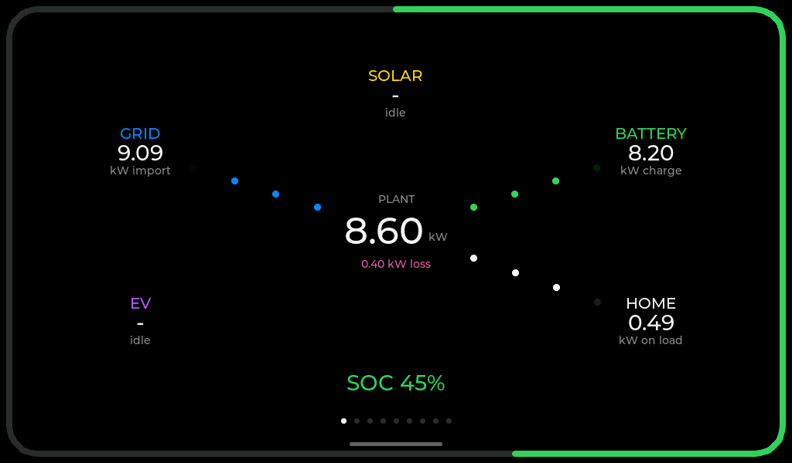 | 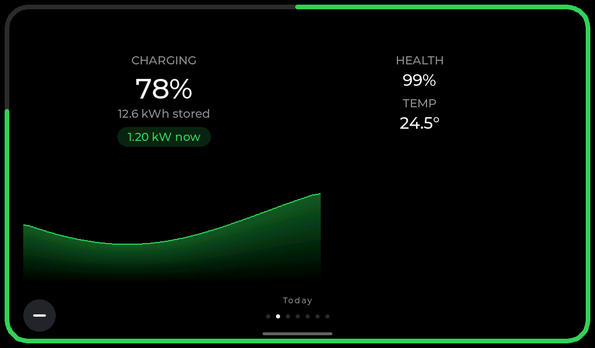 |
| **Power**: what is happening right now. Solar at the top, battery and home to the right, grid and EV to the left, all around the plant in the middle, which shows its own power and, below it in pink, what the system as a whole is losing in conversion and standby. When the plant is off grid, the grid leg reads **Off** in amber over "contactor open". Dots run along each leg in the direction the power is going: slowly near zero, faster as it rises towards 20 kW. The bar around the edge is your battery's state of charge. A warning (an alarm, no data, a stale reading) takes the line under the plant's figure instead of the loss.<br><br>*Works on all three sources when the values are available.* | **Battery**: charge level, kWh stored, and what it is doing now, over the day's charge curve. Health and temperature on the right.<br><br>*Works on all three sources. On Modbus, temperature needs an inverter added under Devices; on Home Assistant, each figure needs its sensor chosen.* |
| 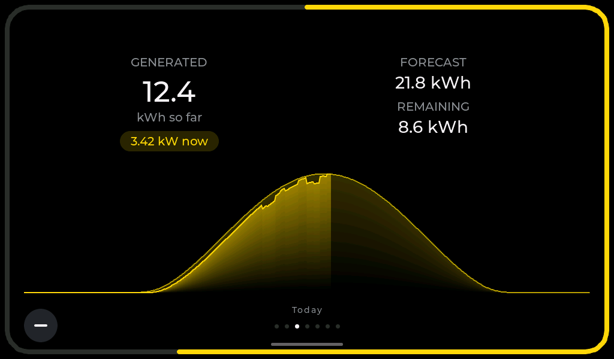 | 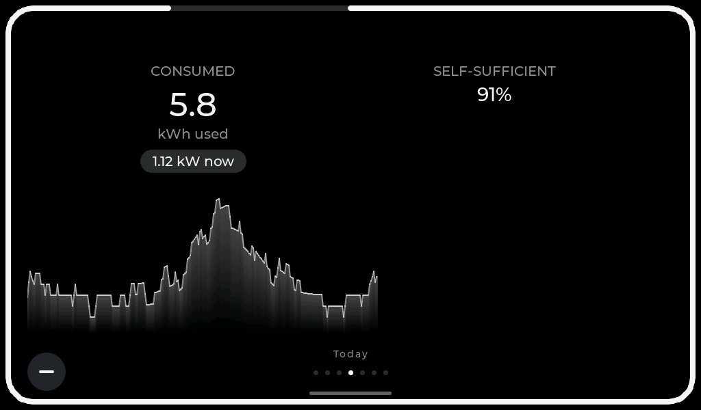 |
| **Solar**: generated so far today and live output, over the day's curve with the forecast behind it. The forecast total and what is still to come are on the right. The bar around the edge is progress against the day's forecast. Live output is what the panels delivered (see [How the figures are worked out](#how-the-figures-are-worked-out)).<br><br>*Works on all three sources.* | **Home use**: everything used today, with what is being drawn now and how self-sufficient you have been.<br><br>*Partial on Modbus and Home Assistant.* The total, live figure and locally recorded curve work. The breakdown by source needs a **SigenStorDisplay Server**. |
| 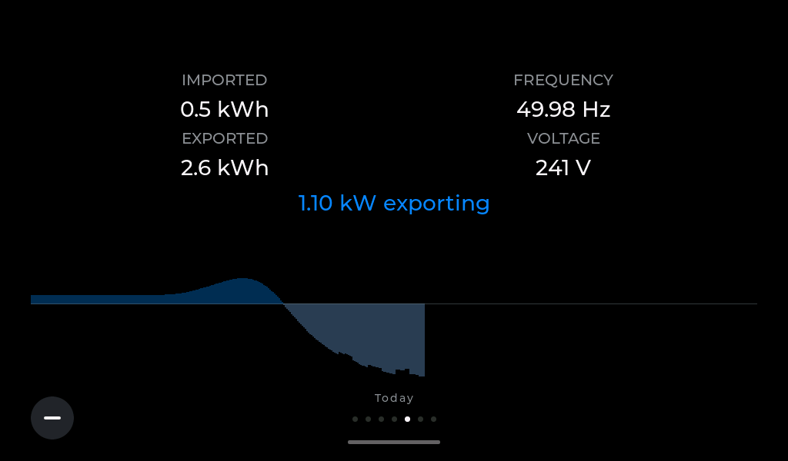 | 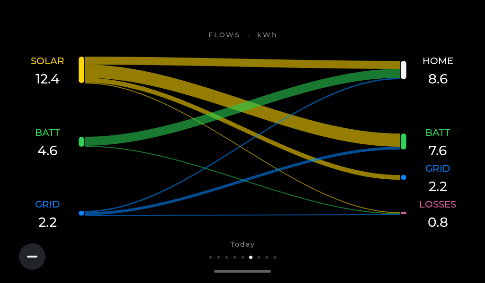 |
| **Grid**: imported and exported today, live frequency and voltage, and the day's import above the line and export below it.<br><br>*Works on all three sources.* Frequency and voltage need an inverter added on Modbus, and are not available from Home Assistant. | **Energy flows**: where today's energy came from and where it went. Sources down the left (solar, battery, grid), destinations down the right (home, EV, battery, grid, and losses), one ribbon per path, its thickness the energy that took it. A ribbon takes the colour of the node it leaves. The LOSSES sink, what the system itself used on the way, appears with SigenStorDisplay 0.47.3 onwards.<br><br>**SigenStorDisplay Server only.** |
| 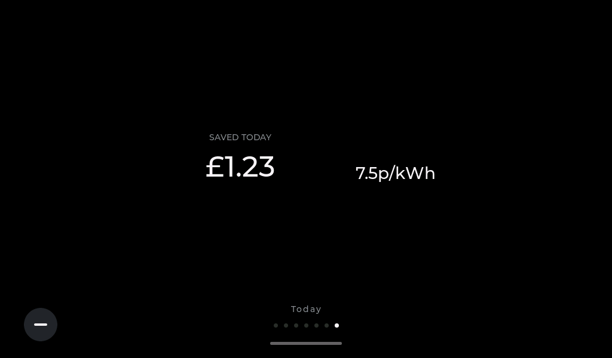 | 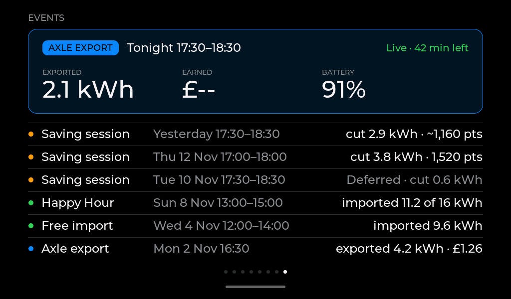 |
| **Cost**: what you have saved today and the unit rate you are paying right now.<br><br>**SigenStorDisplay Server only.** | **Events**: Octopus Saving Sessions, weekend Happy Hours, other free-import periods and Axle events. See [Events](#events) below.<br><br>**SigenStorDisplay Server only**, from version 0.45.0; two at once from 0.48.0, and every booked event from 0.48.1. |
| 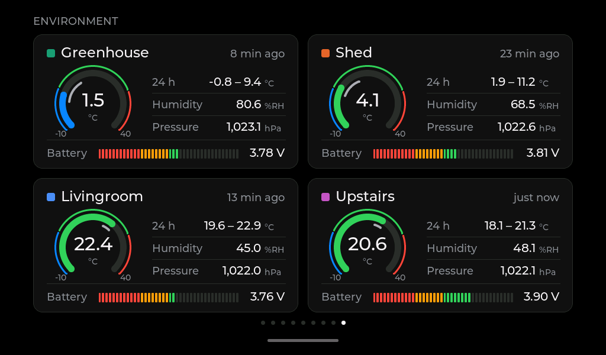 | |
| **Environment**: your room and outdoor sensors from an **EnViOT Display** server, up to four. Each card has the temperature on a gauge with the server's cold, ok and hot bands around it, the last 24 hours' lowest and highest, two more readings (humidity and pressure, or whichever the server puts on its cards) and the sensor's battery. A sensor that has gone quiet is greyed out; one with an alert gets a red outline and the alert's name.<br><br>*Works with any source.* Needs an EnViOT Display server, set up under **Data** (see [Environment sensors](#environment-sensors-optional)). | |

Behind the battery, solar, home and grid figures is that day's own curve:

- **Modbus:** the curves fill from when the panel was switched on.
- **Home Assistant:** the panel restores today's curves from Home Assistant's history after
  its first successful reading, a two-hour window at a time between live readings. Where
  there is no history, the curves fill from switch-on.
- **SigenStorDisplay Server:** the whole day is fetched, so the curves are complete
  straight away, and refreshed every five minutes.

### Events

The Events screen is built around what is happening now:

- **Running events** each get a card across the top, opened out with their figures: how
  much has been cut and the points so far for a Saving Session, how much came in free, or
  what has been exported and earned for an Axle event, plus the battery's run since the
  start, and how long is left. Two that overlap, such as an Axle export during a Saving
  Session, get a card each.
- **Booked events** are listed next, soonest first, each saying how long until it starts
  and anything known ahead (an Axle event's price, a Happy Hour's free allowance). Each
  gets its card when it goes live.
- **Finished events** fill the rest of the screen, newest first, each with its result. A
  session you sat out says **Deferred**.
- With nothing running or booked, the latest finished event takes the card, so the screen
  leads with a result rather than a bare list.

The list is fetched every five minutes, and the countdowns move on between fetches: a
booked event goes live on time by the panel's own clock.

### Past days

With a **SigenStorDisplay Server**, **−** and **+** buttons sit in the bottom corners of
every screen except Power:

- **−** steps back a day, up to seven days.
- **+** steps forward again.
- The day you are looking at is named just above the page dots.
- Left alone for two minutes, the panel goes back to today by itself.

The Power screen always stays live. On Modbus and Home Assistant there is no stored history
to step back into, so the buttons do not appear.

### When something needs attention

Problems show as a line across the top of whichever screen is up, with the screen still
visible underneath. **Tap the line** to open the settings page that fixes it.

| Colour | Means |
|---|---|
| Grey | Something is in progress: connecting to WiFi, setting the clock, waiting for the first reading. It passes by itself. |
| Amber | Something needs setting up: no WiFi, or no data source configured yet. |
| Red | Set up, but refused or unreachable: a rejected code or token, or a source that does not answer. |

The messages themselves are listed under [Troubleshooting](#troubleshooting).

## How the figures are worked out

**With a SigenStorDisplay Server, the panel is a renderer, not a calculator.** The server
works out every derived figure (house load, the daily totals, savings, tariff slots, the
flows) where it can be tested, and the panel draws what it is sent. On Modbus and Home
Assistant there is no server to defer to, so the panel works out the few figures below
itself, with the same formulas the server uses.

**House load is measured on the AC side.** With no home/load sensor of your own, the panel
uses:

```
home = max(0, grid + plant − AC charger)
```

`plant` is the power at the plant's AC terminals; it is negative while the plant takes AC
in (charging from the grid). An AC car charger is on the house wiring, so it comes off; a
DC charger takes its power before the plant's AC terminals, so it is already outside
`grid + plant`. This keeps the system's own losses (conversion, standby, battery heating)
out of the house figure: the older DC-side sum, `PV − battery + grid − EV`, counted about
0.4 kW of phantom house load on a grid-charging night. That older sum is still the
fallback where there is no plant figure, and then no loss is shown.

**Solar is what the panels delivered.** Where the PV strings can be read (voltage ×
current, summed over every string of every inverter), Solar is the larger of that and
Sigenergy's own PV figure. Sigenergy's figure is reported after the system's losses and
reads nothing at all in weak sun, so on its own it under-reads; the larger of the two also
covers sensor error at low light. Without string data, Solar is Sigenergy's figure.

**The loss under PLANT is the system's total loss:**

```
losses = solar − battery − plant − DC charger
```

using the same Solar as the Solar node, so on the Power screen Solar plus battery out
equals plant plus loss. It is hidden at 5 W and below, where a reading is sensor noise,
and whenever the line under the plant has a warning to show instead.

**By source:**

- **Modbus:** the plant's registers give grid, plant and battery power. The AC and DC
  chargers are read apart. The strings are read from each inverter added under Devices
  (up to 16 per inverter); an inverter that refuses those reads is left alone for ten
  minutes, and until every inverter's strings are known the panel uses Sigenergy's figure.
- **Home Assistant:** from the sensors you choose. Choose **PV1–PV4 voltage and current**
  if you have them (the Sigen integration's are `sensor.sigen_inverter_pv1_voltage` and so
  on). A string counts only when both its sensors are chosen, and if one is unavailable
  the panel falls back rather than show a total short by a string. A home/load sensor you
  choose is used as it is; Sigen's own consumed-power sensor may count the losses as
  house, so leave it unchosen to have the panel do the AC-side sum.
- **SigenStorDisplay Server:** the server's own figures: the total loss from 0.47.6, and
  Solar on the same basis from 0.47.7. Today's solar total stays the server's.

**Timing.** Live figures are read every five seconds by default (**Reading: Every** under
Data). Today's charts and the events list refresh every five minutes, a past day you are
looking at every fifteen. A failed read
is retried with a growing pause, up to a minute, and the banner says so. The device clock
runs in UTC; local time comes from the reading, so the overnight hours cannot drift with
an outage.

## Installing

### 1. Flash the firmware

Plug the panel's UART USB-C port into a computer, switch it on, and open this page in
**Chrome or Edge**:

### → [Install SigenStorPanel](https://markab.github.io/SigenStorPanel/)

It flashes over WebSerial, with no flashing tool to download. Safari and Firefox cannot
do this, and neither can anything on an iPhone or iPad.

The panel's USB port goes through a WCH CH340 serial chip, and **a Mac needs WCH's
driver first**. Without it, the panel's serial port does not appear:

1. Download `CH34xVCPDriver.dmg` from WCH's
   [ch34xser_macos](https://github.com/WCHSoftGroup/ch34xser_macos) repository on GitHub.
2. Open it and drag **CH34xVCPDriver** into Applications.
3. Open CH34xVCPDriver from Applications and click **Install**.
4. Allow it in **System Settings → General → Login Items & Extensions → Driver
   Extensions**.

Windows and Linux normally have the driver already.

If the installer cannot connect, hold **BOOT**, press and release **RST**, let go of
BOOT, and try again.

After the first flash, the panel updates itself over WiFi (see [Updates](#updates)).

### 2. Join it to your WiFi

On first boot the panel looks for networks and lists them.

<p align="center">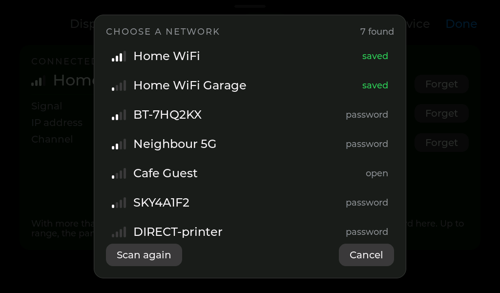</p>

1. Tap your network.
2. Type its password on the on-screen keyboard and tap **Join**.

The panel remembers up to five networks. With more than one in range, it joins the
strongest. To add another later, open **WiFi** in Settings.

It needs a 2.4 GHz network: the ESP32-C6 that provides the panel's WiFi does not do 5 GHz.

### 3. Choose and configure a data source

Open Settings (swipe up), then **Data**. Choose the source at the top. A change of source
takes effect after a restart; the panel offers one.

<p align="center">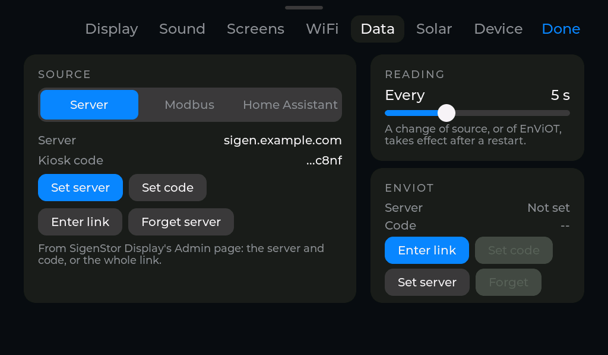</p>

#### Direct Modbus

1. Choose **Modbus**.
2. Tap **Set** and enter the IP address of your inverter or gateway.
3. Optionally, tap **Edit** by Devices. Add your inverter for battery temperature, grid
   frequency and voltage, the daily totals, and its PV strings, which Solar and the loss
   under PLANT are measured from. Add a charger, if you have one, for EV power, and tick
   **DC charger** on an inverter with one built in. Use the IDs the Sigen app lists. The
   plant itself is `247` unless you have changed it.

Do two things outside the panel, or it will not be able to connect:

- **In the Sigen app**, allow Modbus TCP access for the panel's IP address. Access is
  granted per address, and a device that has not been added gets no reply. The panel's
  address is on the **Device** page.
- **In your router**, give the panel a fixed (reserved) IP address. Otherwise the
  permission you just granted stops working the next time addresses are handed out. The
  panel's MAC address, which the router asks for, is on the Device page too.

Data should appear within a few seconds.

#### SigenStorDisplay Server

Once it is available, choose **Server**. The server's Admin page gives each display unit
a server address and a kiosk code. Enter them one of two ways:

- **Set server** and **Set code**, typed separately. Dashes and capitals in the code don't
  matter.
- **Enter link**, for the whole enrolment link in one go.

The code is read-only: the panel can show the server's data but change nothing. Revoke it
on the server to cut the panel off.

#### Home Assistant

You need:

- a Home Assistant the panel can reach;
- energy sensors from any integration;
- a long-lived access token.

To make the token, create a dedicated local non-administrator user in Home Assistant for
the panel. Sign in as that user, open its profile, and create a
[**long-lived access token**](https://developers.home-assistant.io/docs/auth_api/#long-lived-access-token).
Avoid using an administrator's everyday token. Revoking this one later removes the panel's
access at once.

1. Choose **Home Assistant**.
2. **Set address**: the base URL, with the scheme and port, such as
   `http://homeassistant.local:8123`.
3. **Set token**: type or paste the token. It is stored on the panel only, and shown
   afterwards as its last few characters.
4. **Sensors: Choose.** Tap each figure and pick its sensor from Home Assistant's own
   list. The list is filtered to sensors in a unit that figure can use, and shows each
   one's current value, so you can see which is live. Voltage and current sensors are
   offered only for the PV string figures, and only those with `pv` in their ID.
5. **EV charger**, under EV power: tap it to step through **Auto**, **AC** and **DC**.
   Only an AC charger is on the house wiring, so only an AC charger comes off house
   load. Auto treats a sensor whose ID contains `dc_charger` as DC (Sigen's own DC
   charger sensor) and anything else as AC, and shows which it chose.

<p align="center">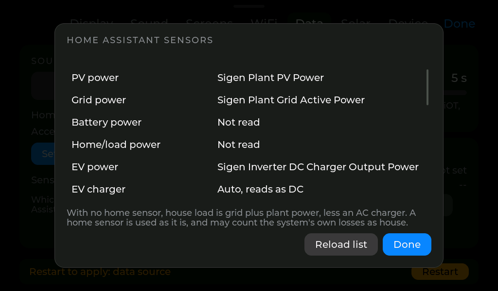</p>

Which sensors matter for house load, Solar and the loss under PLANT is explained under
[How the figures are worked out](#how-the-figures-are-worked-out).

The panel sends one [`POST /api/template`](https://developers.home-assistant.io/docs/api/rest/#post-apitemplate)
per reading. Home Assistant answers with only the chosen sensors and their units, so the
panel never downloads every state. In this mode the panel never opens a Modbus
connection.

## Settings

Everything below is in the sheet that slides up over the screens. It has seven pages,
**Display**, **Sound**, **Screens**, **WiFi**, **Data**, **Solar** and **Device**, and you
swipe left and right between them.

Most changes take effect straight away. The ones that need a restart are marked ↻. Changing
one puts up a bar listing what is waiting, with a button to restart.

Every setting is kept in the panel's own flash. It survives restarts, power cuts and
updates, and nothing is stored anywhere else.

### Display

<p align="center">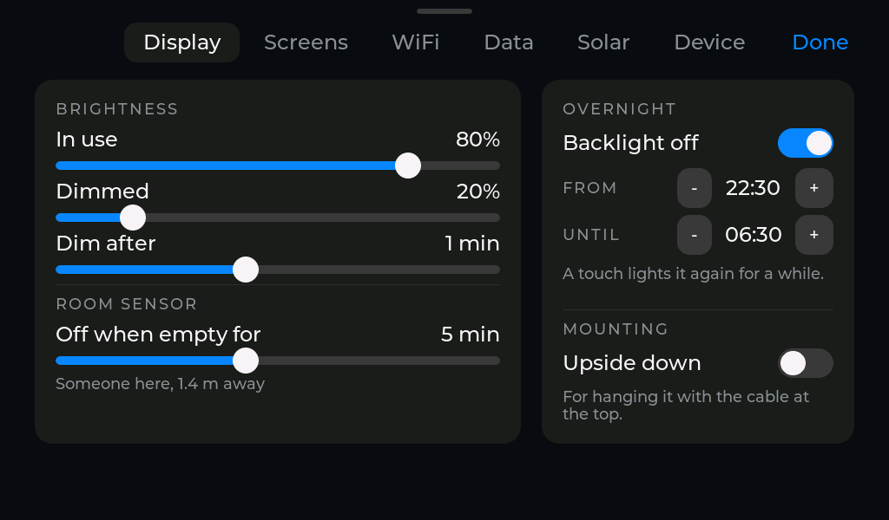</p>

<table>
<tr><th width="32%">Option</th><th>What it does</th></tr>
<tr><td><strong>In use</strong></td><td>Normal brightness. The screen shows it live while you drag.</td></tr>
<tr><td><strong>Dimmed</strong></td><td>How dim it goes when left alone. It dims rather than going dark, so it stays readable from across the room.</td></tr>
<tr><td><strong>Dim after</strong></td><td>How long without a touch before it dims, or never.</td></tr>
<tr><td><strong>Off when empty for</strong></td><td>With the optional room sensor (see <a href="#room-sensor-optional">Room sensor</a>): how long the room must be empty, with nobody touching the panel, before the backlight goes off. Never, or 1 to 60 minutes. Someone walking in brings it straight back. Below the slider is what the sensor sees right now.</td></tr>
<tr><td><strong>Overnight: Backlight off, From, Until</strong></td><td>Hours to switch the backlight off completely. <strong>Off means off, not dimmed.</strong> A touch lights it again for a while. Inside these hours, the room sensor does not wake it.</td></tr>
<tr><td><strong>Upside down</strong> ↻</td><td>For hanging the panel with the cable at the top.</td></tr>
</table>

The screen is IPS, so a fixed image cannot burn in, and there is no need to keep it moving.

### Sound

<p align="center">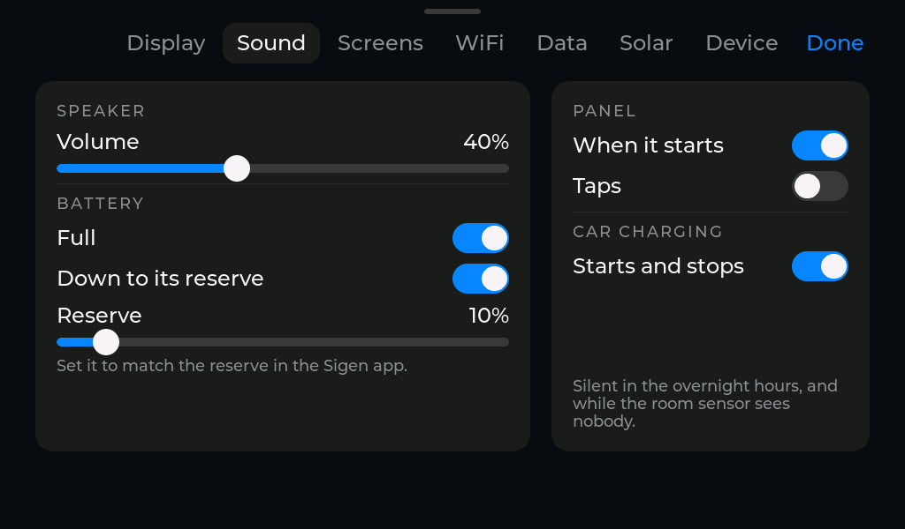</p>

Short, quiet chimes through the panel's speakers. **They stay silent in the overnight
hours set under Display, while the room sensor sees nobody, and during an install**, so
they are only heard by someone who is there. Switching a sound on plays it, so you know
which is which.

<table>
<tr><th width="32%">Option</th><th>What it does</th></tr>
<tr><td><strong>Volume</strong></td><td>For all of them. Off silences the panel completely. Letting go of the slider plays a blip at the new level.</td></tr>
<tr><td><strong>Battery: Full</strong></td><td>Three rising notes when the battery reaches 100%. Once per charge: it has to fall below 97% before it can chime again.</td></tr>
<tr><td><strong>Battery: Down to its reserve</strong></td><td>Three falling notes when the battery drops to the <strong>Reserve</strong> level. Set that to match the reserve in the Sigen app; the plant does not report it, so the panel cannot read it. Once per discharge: the battery has to climb 3% above it first.</td></tr>
<tr><td><strong>Panel: When it starts</strong></td><td>Four rising notes when the panel starts up. Heard when nobody restarted it, it means the panel restarted by itself: see <a href="#the-panel-restarts-by-itself">The panel restarts by itself</a>.</td></tr>
<tr><td><strong>Panel: Taps</strong></td><td>A soft tick for each tap. Swipes stay silent.</td></tr>
<tr><td><strong>Car charging: Starts and stops</strong></td><td>Two notes up when a car has been charging for 30 seconds, two down when it has stopped for a minute, so the pauses chargers make do not count. Needs a source that reports the EV charger.</td></tr>
</table>

The panel only ever chimes for what it reads; a sound for new grid events is not
implemented.

### Screens

<p align="center">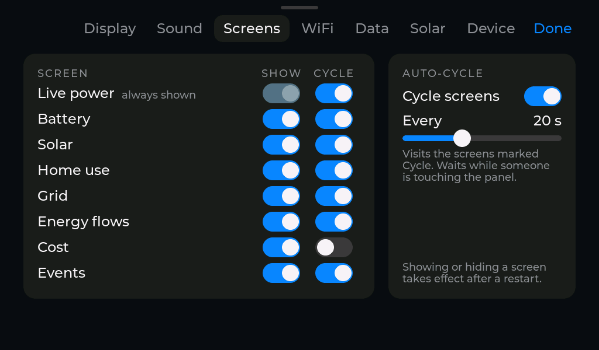</p>

<table>
<tr><th width="32%">Option</th><th>What it does</th></tr>
<tr><td><strong>Show</strong> ↻</td><td>A tick per screen for whether it appears at all. Power is always shown. On Modbus and Home Assistant, Energy flows, Cost and Events are unavailable.</td></tr>
<tr><td><strong>Cycle</strong></td><td>A second tick per screen for whether the auto-cycle stops on it.</td></tr>
<tr><td><strong>Cycle screens, Every</strong></td><td>Steps through the screens marked Cycle by itself, this often. It waits while someone is touching the panel.</td></tr>
</table>

A screen added in a newer version appears by itself after the update; the choices you
made for the others are kept.

### WiFi

<p align="center">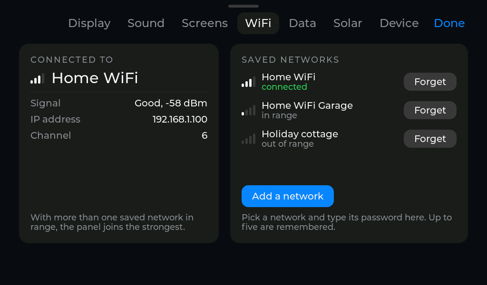</p>

<table>
<tr><th width="32%">Option</th><th>What it does</th></tr>
<tr><td><strong>Connected to</strong></td><td>The network in use, its signal, the panel's IP address and the channel.</td></tr>
<tr><td><strong>Saved networks</strong></td><td>Up to five. <strong>Forget</strong> asks you to tap again to confirm.</td></tr>
<tr><td><strong>Add a network</strong></td><td>Opens the network list. Pick one and type its password.</td></tr>
</table>

### Data

<table>
<tr><th width="32%">Option</th><th>What it does</th></tr>
<tr><td><strong>Source</strong> ↻</td><td><strong>Server</strong>, <strong>Modbus</strong> (the default) or <strong>Home Assistant</strong>. Below it are that source's own settings, as described under <a href="#installing">Installing</a>.</td></tr>
<tr><td><strong>Forget server</strong></td><td><em>Server only.</em> Clears the server address and code.</td></tr>
<tr><td><strong>Reading: Every</strong></td><td>How often the live figures are read, in seconds. <code>5</code> is the default. The day's charts update every five minutes whatever this says.</td></tr>
<tr><td><strong>EnViOT</strong> ↻</td><td>An EnViOT Display server for the <strong>Environment</strong> screen, set alongside whichever source you use. <strong>Enter link</strong> takes the whole enrolment link from EnViOT Display's <em>Account → Kiosk devices</em>; <strong>Set server</strong> and <strong>Set code</strong> take its two halves. <strong>Forget</strong> clears both.</td></tr>
</table>

### Solar

<p align="center">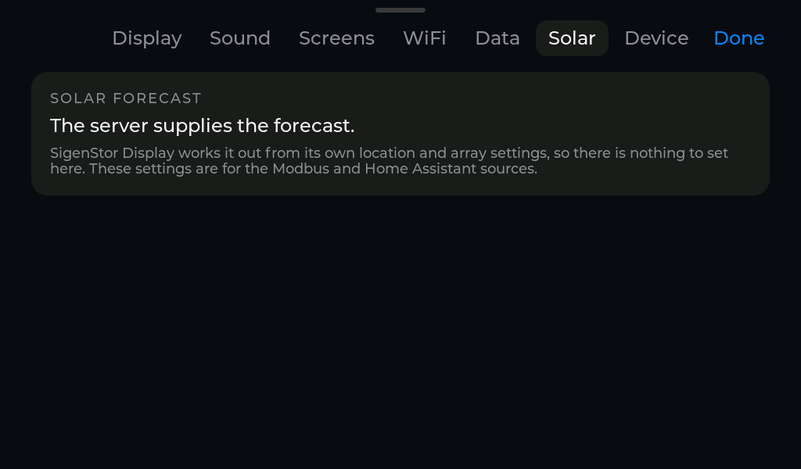</p>

With a **SigenStorDisplay Server**, the server supplies the forecast and there is nothing
to set here. On **Modbus**, the panel calculates it from the settings below. On **Home
Assistant**, choose **Off**, **This panel** (calculated from the settings below), or
**From HA** (the forecast sensors chosen under Data, Sensors).

<table>
<tr><th width="32%">Option</th><th>What it does</th></tr>
<tr><td><strong>Latitude / Longitude</strong></td><td>Where your panels are. West is negative. <strong>Leave them unset for no forecast</strong>; the Solar screen then hides its forecast rather than showing an empty one.</td></tr>
<tr><td><strong>System efficiency</strong></td><td>Everything between the panels' rating and your meter: inverter efficiency, wiring, dirt on the glass.</td></tr>
<tr><td><strong>Inverter limit</strong></td><td>The most your inverter can put out, in kW, or no limit.</td></tr>
<tr><td><strong>Arrays</strong></td><td>One per roof face with panels on it, up to four. <strong>Size</strong> is the panels' rating in kWp. <strong>Tilt</strong> is the angle from flat. <strong>Facing</strong> is a compass bearing: <code>180</code> due south, <code>90</code> east, <code>270</code> west.</td></tr>
</table>

The panel's own forecast takes today's hourly irradiance forecast for your location from
[Open-Meteo](https://open-meteo.com/) and works out what your arrays would make of it, with
the same solar-position and roof-angle model as SigenStorDisplay, so the two agree for the
same inputs.

### Device

<p align="center">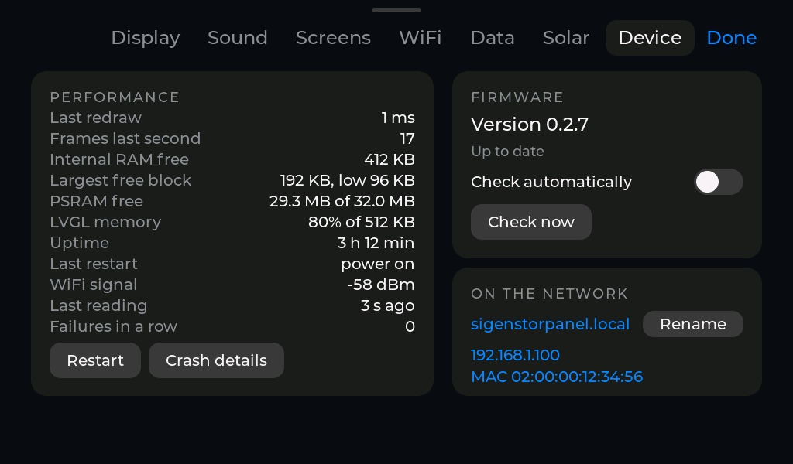</p>

<table>
<tr><th width="32%">Option</th><th>What it does</th></tr>
<tr><td><strong>Performance</strong></td><td>How fast the screen is drawing, free memory, uptime, WiFi signal, and how long ago the last reading arrived. <strong>Largest free block</strong> is the biggest single piece of internal memory, which secure connections and the WiFi driver depend on, followed by the lowest it has been since start-up. <strong>Last restart</strong> says why the panel last started: power on, restarted on purpose, or, in amber, a crash, a watchdog or a power dip. <strong>Failures in a row</strong> turns amber with the reason when readings are failing.</td></tr>
<tr><td><strong>Restart</strong></td><td>Restarts the panel. Needed after any ↻ change above. Tap twice: the first tap asks you to confirm.</td></tr>
<tr><td><strong>Crash details</strong></td><td>The last crash the panel saved, which stays until the next one: which task, why, and the code addresses. See <a href="#the-panel-restarts-by-itself">The panel restarts by itself</a>.</td></tr>
<tr><td><strong>Firmware</strong></td><td>The version running, <strong>Check now</strong>, <strong>Install</strong> and <strong>Check automatically</strong>. See <a href="#updates">Updates</a>.</td></tr>
<tr><td><strong>On the network</strong></td><td>The panel's name, IP address and WiFi MAC address. The MAC is what your router lists when you reserve an address.</td></tr>
<tr><td><strong>Rename</strong> ↻</td><td>What the panel calls itself on your network. The default is <code>sigenstorpanel</code>, which answers as <code>sigenstorpanel.local</code>. Change it if you have more than one.</td></tr>
</table>

## Updates

New versions are published on this repository's
[Releases](https://github.com/markab/SigenStorPanel/releases) page and on the installer
page, and the panel installs them over WiFi:

- **Check now**, on the Device page, asks whether there is a newer version. **Install**
  appears when there is one.
- **Check automatically** is off by default, so the panel contacts nothing but your own
  network and its data sources unless you ask it to. With it on, the panel checks after
  it starts and then every 12 hours, and a dot on the Device tab says an update is
  waiting. **Installing is always your choice**: the panel never installs by itself.
- During an install the panel shows its progress. It downloads the whole new version
  first, then writes it with the screen dark for a few seconds, and restarts into it.
  Sounds stay quiet throughout.
- **Settings are kept**: networks, codes, tokens and every choice under Settings survive
  an update.
- **The old version stays as a fallback.** The flash holds two copies of the firmware,
  and the new one goes into the spare. If it fails to start, the panel goes back to the
  one it was running.

One exception: a panel on **0.1.0** cannot update itself, because that version's updater
crashes on the download. Flash it once more from the
[installer page](https://markab.github.io/SigenStorPanel/); from 0.1.1 on, updates
install over WiFi.

The installer page always flashes the newest version, so it also works to recover a panel,
or to go back to a clean state.

## Troubleshooting

### Messages across the top

| Across the top | What it means |
|---|---|
| **No WiFi** | No saved network is in range. Tap to choose one. |
| **Connecting to WiFi...** | Joining your network. It should pass in a few seconds. |
| **… not set up** | On WiFi, but the chosen source is missing its address, code or token. Tap to enter it. |
| **Setting the clock...** | The panel needs the time from the internet before it can make a secure connection. It passes by itself once your network lets it reach a time server. |
| **Waiting for data...** | Configured, but nothing has arrived yet. Normal just after a restart. |
| **The server rejected this panel's code** | *Server only.* The kiosk code was revoked. Create a new one on the server and enter it. |
| **Home Assistant rejected the token** | Home Assistant answered 401 or 403. Make a new long-lived token and check that its user is still active. |
| **Cannot reach …** | The source did not answer, with the reason in brackets. Check its address. On Modbus, also check the panel is still allowed in the Sigen app. |

### Modbus stopped working

If a Modbus setup worked and then stopped, the usual cause is that the panel's IP address
changed. That quietly invalidates the permission granted in the Sigen app. Reserve the
address in your router and grant it again.

### A screen or a figure is missing

- **Energy flows, Cost or Events is missing:** they need a SigenStorDisplay Server. On
  Modbus and Home Assistant they are removed rather than shown empty.
- **Events shows only one of two events at the same time:** the server is older than
  0.48.1 (booked events) or 0.48.0 (running ones). Update the server; the panel needs
  nothing.
- **Environment is missing:** it appears only after an EnViOT Display server is set
  under Data *and* the panel has restarted. Check it is ticked under Screens.
- **Grid frequency and voltage, or battery temperature, show `--` on Modbus:** add your
  inverter under Data, Devices.
- **No loss under PLANT:** it is hidden at 5 W and below, while the line has a warning
  to show, and when the plant's power is not known (on Home Assistant, choose the plant
  sensor).

### The panel restarts by itself

The four-note startup chime with nobody touching the panel means it restarted. To find out
why, open **Settings → Device**:

1. **Last restart** says what started it. *Power dip* points at the power supply, not the
   firmware: try another supply or cable. *Crash* or a *watchdog* is the firmware.
2. Tap **Crash details**. It shows the task that crashed, why, and the code addresses,
   with the build they belong to. Check that it says **this firmware**: a crash saved by
   an earlier version stays until the next one replaces it.
3. Take a photo of it and open an issue with it. The addresses are turned into functions
   and lines with `tools/decode_crash.sh` (see [Building it yourself](#building-it-yourself)).

**Largest free block**, also on the Device page, shows the lowest that internal memory's
biggest piece has been since start-up. The restarts seen so far were the WiFi driver
needing one large piece for a burst of data and not finding it. If the low figure stays
well above 64 KB, there is room for that.

### Buttons and power

**Holding BOOT for 5 seconds restarts the panel.** The slide switch on the side cuts power
outright. There is no other button to press in normal use.

## Environment sensors (optional)

If you also run **EnViOT Display**, the server for EnViOT temperature and humidity sensors,
the panel can show them on a screen of its own, beside whichever SigenStor source you use.

1. In EnViOT Display, go to **Account → Kiosk devices**, add one (say "Hall panel") and copy
   its enrolment link.
2. On the panel, open **Settings → Data**, tap **Enter link** under **EnViOT**, and type or
   paste the link. Over HTTPS the certificate is checked, as for the SigenStor server; on
   your own network `http://` to EnViOT Display's address works too.
3. Tap **Restart** on the bar along the bottom of Settings ("Restart to apply: Environment
   screen"). The **Environment** screen appears after **Events**; it can be hidden or left
   out of the cycle under **Screens** like any other.

The panel reads the sensors once a minute and each one's 24-hour range every five minutes.
The code is read-only: a kiosk can see the readings but change nothing. If EnViOT Display
refuses the code (the kiosk device was deleted, say), the screen says so and the panel tries
again every ten minutes.

## Room sensor (optional)

A [Waveshare HMMD mmWave sensor](https://www.waveshare.com/wiki/HMMD_mmWave_Sensor) lets
the panel switch its backlight off when nobody is in the room and back on when someone
walks in. It also keeps the sounds quiet while the room is empty. Without one, nothing
changes.

It plugs into the **UART1** socket beside the WiFi module, a 4-pin HY2.0 (2.0 mm,
Grove-style) connector. TX and RX cross over:

| UART1 pin | Sensor pin |
|---|---|
| 1 RX (GPIO48) | **TX** |
| 2 TX (GPIO47) | **RX** |
| 3 3V3 | **3V3** |
| 4 GND | **GND** |

The sensor's fifth pin, OT2, is not needed. A sensor that goes silent is ignored, so a
loose wire cannot leave the panel dark. Set how long the room must be empty under
**Display**. More detail, including an alternative on the IO breakout header, is in
[docs/HARDWARE.md](docs/HARDWARE.md).

## Privacy and security

- **What the panel stores:** your WiFi passwords, the server's kiosk code, the Home
  Assistant token, the EnViOT code and your settings, in its own flash and nowhere else.
- **What the panel contacts:** your chosen data source; the EnViOT Display server, if
  set; a public time server (`pool.ntp.org`, else `time.nist.gov`) for the clock;
  [Open-Meteo](https://open-meteo.com/), only when the panel makes its own solar forecast,
  sending the latitude and longitude you set; and GitHub Pages, only when checking for or
  installing an update. Nothing else, and nothing about your plant is sent anywhere but
  your own source.
- **Secure connections are checked.** Over HTTPS the panel validates the certificate
  against a built-in set of public certificate authorities, so a code or token is never
  handed to an impostor. Codes and tokens are shown on the panel only as their last few
  characters.
- **Read-only credentials.** The SigenStorDisplay kiosk code and the EnViOT code can read
  but change nothing. For Home Assistant, use a dedicated non-administrator user, as
  described above. Over plain `http://` the token travels unencrypted, which is fine
  within your own network; use `https://` for anything further.
- **Modbus has no authentication of its own.** The plant's only protection is the per-IP
  allow list in the Sigen app, which is why the panel's address should be reserved.
- **No web interface.** The panel runs no server for other devices to talk to. It answers
  to its `.local` name on your network and nothing more.

## Hardware

| | |
|---|---|
| Board | Elecrow CrowPanel Advanced 10.1″ ESP32-P4 HMI, **V1.2** tested |
| Display | 1024×600 IPS, EK79007 over 2-lane MIPI-DSI, PWM backlight |
| Touch | GT911, I2C |
| MCU | ESP32-P4 (silicon v1.3 tested), 32 MB PSRAM, 16 MB flash |
| WiFi | through the on-board ESP32-C6 over SDIO (esp-hosted), 2.4 GHz |
| Sound | I2S amplifier and the board's speakers |
| USB serial | WCH CH340, needing WCH's driver on a Mac |
| Buttons | BOOT (hold 5 s to restart) and RST; a slide switch for power |
| Optional | Waveshare HMMD mmWave room sensor on UART1 |

There is no battery and no soft power-off: the slide switch cuts power outright. Pins,
timings, the WiFi wiring by board revision, and what is confirmed so far are in
[docs/HARDWARE.md](docs/HARDWARE.md).

## Building it yourself

The firmware builds with [PlatformIO](https://platformio.org/), on pioarduino
`55.03.38-1` (Arduino-ESP32 3.3.8, ESP-IDF 5.5), with LVGL 8.4 and GFX Library for
Arduino 1.6.8. The project keeps its own PlatformIO core in `~/.platformio-sigenstorpanel`
(set by `core_dir` in `platformio.ini`), so it cannot disturb other projects on an older
core; the first build downloads the toolchain there.

```bash
pio run -e panel                         # build the firmware
pio run -e panel -t upload -t monitor    # flash over USB, then watch the serial log
```

Several ESP32 boards can show up on the same serial port name. Before flashing, check
which one is attached:

```bash
esptool.py --chip esp32p4 read_mac
```

### The simulator

Screens are developed against canned readings on the desktop rather than by reflashing,
and every screenshot above came from that simulator. It needs SDL2 (`brew install sdl2`),
and should be run from the repository root so it finds `test/fixtures`:

```bash
pio run -e sim && .pio/build/sim/program
```

| Key | Does |
|---|---|
| `n` or space, `p` | Next and previous fixture (a canned reading) |
| `]` and `[` | Next and previous screen |
| `s` | Open or close Settings (⌘V pastes into a text field) |
| `d` | Show the parsed data behind the screen |
| `-` and `=` | Step back and forward through past days |
| `r` | Turn the auto-cycle on or off |
| `o` | Step through the banner's messages |

| Option | Does |
|---|---|
| `--shot <dir>` | Renders every screen, fixture and settings page to images, then exits |
| `--selftest` | Runs the checks that need no hardware, then exits |
| `--live` | Reads your own SigenStorDisplay server instead of the fixtures |
| `--fixtures` | Uses the fixtures even when a server is saved |
| `--modbus` | Shows the screen set a Modbus panel has |

To see your own server's data, paste its enrolment link into the sheet (`s`, Data,
Server). The sim saves it to `~/.config/sigenstorpanel/sim-server` (readable only by you,
outside the repository) and goes live by itself on later runs; **Forget** removes it.

`--selftest` covers, among other things: the Home Assistant template, sensor list and unit
handling; the Modbus register decoder; the house load, Solar and loss sums; the events
parser; the history ring; the solar forecast model; the overnight window; the sound
triggers; and the room sensor's output.

### Where things are

| Path | Holds |
|---|---|
| `src/ui_panel/` | The panel's own screens and the settings sheet |
| `src/device/` | Everything that needs the hardware: network, sources, display, sound, room sensor, updater, crash report |
| `src/` | The shared data layer, copied from SigenStorPuck: the reading model, parsers, Modbus registers, sums, history, forecast |
| `src/sim/` | The simulator and the self-tests |
| `src/board_crowpanel_101.h` | Every pin and tunable |
| `test/fixtures/` | The canned readings the simulator plays |
| `tools/` | Font generation, release packaging, the upstream drift check, the crash decoder |
| `web/installer/` | The installer page |
| `docs/` | Hardware notes, the release process, images |

Files shared with SigenStorPuck are changed there first and copied here unchanged.
[UPSTREAM.md](UPSTREAM.md) lists them, and `tools/upstream_drift.sh` shows any that differ.

### Decoding a crash

From a photo of **Crash details**:

```bash
tools/decode_crash.sh <build> <address>...
tools/decode_crash.sh f01804d50 4ff087d6 4ff0878c 400bf3d4
```

`<build>` is the build the crash view names. Every build of `main` and every release keeps
its `firmware.elf` as a CI artifact for 90 days, and the script finds the matching one
(it needs the `gh` command, signed in). A local build of the same commit will not do: it
lays the code out differently. Addresses in the chip's ROM are looked up in Espressif's
ROM image.

### Releases

How releases, the installer page and updates are published is in
[docs/RELEASING.md](docs/RELEASING.md).

## Home Assistant scope

Home Assistant provides:

- live power and battery values;
- today's totals, for the sensors you choose;
- the PV strings, for Solar and the system's loss;
- an optional solar forecast, from Home Assistant sensors or the panel's own model.

One optional history fetch restores today's charts after a restart. Without usable
history, the charts fill from switch-on.

Deliberately not implemented: browsing previous days, the detailed source-to-sink flows,
tariffs and costs, and grid events.

## Credits

SigenStorPanel shares its data layer with
[SigenStorPuck](https://github.com/markab/SigenStorPuck), by the same author. Third-party
material, and what is used rather than copied, is listed in [NOTICE](NOTICE): the
installer is built on esp-web-tools (Apache-2.0), the fonts are Montserrat (SIL Open Font
License 1.1), and the display's initialisation sequence comes from Espressif's
esp_lcd_ek79007 component through GFX Library for Arduino.
